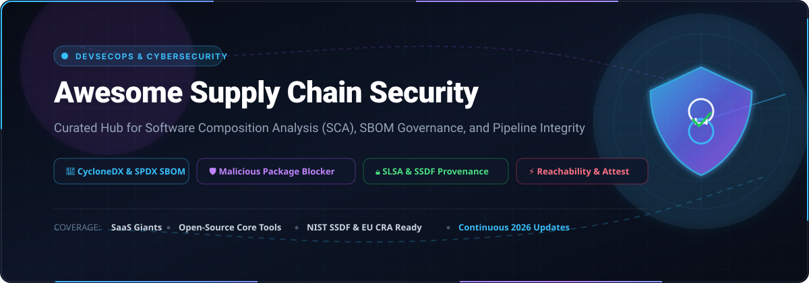

# 🛡️ Awesome Supply Chain Security

<p align="center">
  
</p>

<p align="center">
  <a href="https://github.com/ishandutta2007/Awesome-Awesome-Awesome"></a>
  <a href="https://discord.gg/jc4xtF58Ve"></a>
  <a href="https://github.com/ishandutta2007/Awesome-Supply-Chain-Security/stargazers"></a>
  <a href="https://github.com/ishandutta2007/Awesome-Supply-Chain-Security/network/members"></a>
  <a href="https://github.com/ishandutta2007/Awesome-Supply-Chain-Security/blob/main/LICENSE"></a>
  <a href="https://github.com/ishandutta2007/Awesome-Supply-Chain-Security/pulls"></a>
  <a href="https://github.com/ishandutta2007"></a>
</p>

---

## 📌 Executive Summary & Scope

A comprehensive, curated landscape of enterprise **SaaS platforms**, **DevSecOps pipeline controls**, and **open-source security tooling** engineered for modern **Software Supply Chain Security**. 

This ecosystem catalog tracks tools designed to protect software development lifecycles (SDLC) against third-party dependency vulnerabilities, malicious package injections (typosquatting, dependency confusion), compromised build pipelines, and untrusted artifact distribution. Whether you need **Software Composition Analysis (SCA)**, **Software Bill of Materials (SBOM)** generation (CycloneDX / SPDX), **provenance verification (SLSA / Sigstore)**, or audit-ready evidence for regulatory frameworks (**NIST SSDF**, **EO 14028**, and the **EU Cyber Resilience Act**), this guide compiles verified data, commercial pricing benchmarks, and community options.

---

## 📑 Table of Contents

- [🌐 Sector Overview & Market Dynamics](#-sector-overview--market-dynamics)
- [🏢 Enterprise SaaS Supply Chain Security Platforms](#-enterprise-saas-supply-chain-security-platforms)
- [🔓 Top Open-Source Supply Chain Security Projects](#-top-open-source-supply-chain-security-projects)
- [🏗️ Reference Supply Chain Security Architecture](#️-reference-supply-chain-security-architecture)
- [📈 Star History](#-star-history)
- [🤝 How to Contribute](#-how-to-contribute)
- [💖 Support & Community](#-support--community)
- [⚖️ Disclaimer](#️-disclaimer)

---

## 🌐 Sector Overview & Market Dynamics

- **Market Size & Rapid Expansion:** The global **Software Supply Chain Security** market is valued at **$5.53 Billion in 2026** and is projected to expand to **$10.10 Billion by 2030**, reflecting a vigorous **Compound Annual Growth Rate (CAGR) of 12.8% to 16.5%**. This acceleration is powered by aggressive government and industry compliance mandates (e.g., US Federal EO 14028, NIST SP 800-218 SSDF, and the EU Cyber Resilience Act) alongside an exponential rise in automated open-source repository attacks.
- **Market Dynamics & Fragmentation:** The sector remains **moderately fragmented**, actively transitioning from isolated, reactive point solutions (standalone CVE scanners and basic SBOM parsers) toward unified **Application Security Posture Management (ASPM)** and proactive artifact firewalls. Rather than a "winner-take-all" monopoly, market share is vigorously contested between established DevSecOps infrastructure giants (JFrog, Snyk, Veracode, Synopsys/Black Duck) and specialized, high-velocity innovators pioneering zero-CVE hardened base images, pre-ingestion malicious package firewalls, and AI-agent code defense (Chainguard, Aqua Security, Legit Security, Apiiro, and Socket).

---

## 🏢 Enterprise SaaS Supply Chain Security Platforms

The table below compiles leading commercial platforms, **sorted in descending order by company scale (market capitalization or latest enterprise valuation)**. Every entry features verified starting tier prices and explicit free tier or evaluation limits.

| Platform & Provider | Company Scale (Valuation / Revenue) | Starting Price (Specific Tier) | Free Tier / Trial Limits | Core Focus & Supply Chain Capabilities |
| :--- | :--- | :--- | :--- | :--- |
| **[JFrog Xray](https://jfrog.com/xray/)** | **~$11.5B Market Cap** *(NASDAQ: FROG; ~$425M+ Annual Revenue)* | **$150 / month** *(Cloud Pro base package; promotional entry from $50/mo)* | **Free Forever**: 2 GB storage, 10 GB monthly data transfer, 2,000 build minutes/month, and basic OSS Xray vulnerability scanning | Unified binary lifecycle management & Artifactory integration; contextual CVE prioritization, IoT/edge package inspection (JFrog Connect), and automated CI/CD gating. |
| **[Snyk](https://snyk.io/)** | **~$7.4B Valuation** *(Dec 2022 round; peak $8.5B; ~$250M+ ARR)* | **$25 / dev / month** *(Team Plan, billed annually; min. 5 devs = $125/mo)* | **Free Forever**: 200 Snyk Open Source (SCA) tests/mo, 100 Snyk Code (SAST) tests/mo, 100 Container tests/mo, 300 IaC tests/mo; unlimited scans on public open-source repos | Developer-first security native to IDEs and pull requests; DeepCode AI remediation, transitive dependency graphing, container scanning, and reachability filtering. |
| **[Veracode](https://www.veracode.com/)** | **~$2.5B Valuation** *(Acquired by TA Associates; ~$300M Annual Revenue)* | **~$10,000 / year** *(Entry standalone Package Firewall / SCA tier; ~$60–$80/dev/mo at scale)* | **14-day Free Trial**: 1 application repo, 100 scan runs, and access to Veracode Security Labs interactive remediation modules | **Package Firewall** halts malicious packages at ingestion before reaching developer environments; AI-driven **Veracode Fix** auto-generates pull requests for flawed dependencies. |
| **[Black Duck](https://www.blackduck.com/)** | **~$2.1B Valuation** *(Acquired by Clearlake Capital & Francisco Partners; ~$220M Rev)* | **$500 / dev / year** *(Code Sight IDE extension, min. 10 seats = $5,000/yr; Enterprise SCA from ~$25k/yr)* | **30-day Free Trial**: Code Sight IDE plugin for VS Code / JetBrains; or 14-day guided enterprise Proof-of-Concept for 20 repos | Enterprise-grade binary and source code SCA, extensive SPDX and CycloneDX SBOM authoring with proprietary metadata, license compliance governance, and NIST SSDF attestations. |
| **[Checkmarx](https://checkmarx.com/)** | **~$1.15B Valuation** *(Acquired by Hellman & Friedman; ~$200M ARR)* | **~$650 / dev / year** *(Checkmarx One SCA/AppSec tier; min. 20 seats = ~$13,000/year)* | **14-day Guided PoC Trial**: Up to 5 monitored repositories and 25 developer seats; includes free permanent access to open-source KICS IaC scanner | Consolidated Checkmarx One platform; real-time Malicious Package Protection, repository health scoring across 12 hygiene factors, and secrets detection for 170+ formats. |
| **[Chainguard](https://www.chainguard.dev/)** | **~$1.12B Valuation** *(Series C Unicorn; $140M funding round led by Redpoint)* | **$250 / dev / month** *(Chainguard Developer tier; Enterprise custom from ~$30k/yr)* | **Free Forever**: Unlimited public pulls of Chainguard Public Developer Images (minimal zero-CVE container images with rolling tags) | Zero-CVE minimal container base images built on Wolfi Linux OS; continuous base-layer vulnerability patching and software attestation (Cosign/SLSA native). |
| **[Aqua Security](https://www.aquasec.com/)** | **~$1.0B Valuation** *(Unicorn, Series E; ~$100M ARR)* | **$849 / month** *($10,188/year for AWS Marketplace Team/Developer Edition)* | **14-day Free Trial**: Up to 20 code repos and 100 cloud container workloads; permanent free developer scanning via open-source Trivy | End-to-end CNAPP with deep supply chain integrity; active integration with OpenSSF Malicious Packages database (`MAL-YYYY-XXXXX`) to quarantine bad packages. |
| **[Sonatype Nexus](https://www.sonatype.com/)** | **~$1.0B Valuation** *(Acquired by Vista Equity Partners; ~$150M ARR)* | **$1,950 / year** *(Nexus Repository Pro Cloud, 25 GB consumption; Self-Hosted from $7,500/yr)* | **Free Forever**: Nexus Repository Community Edition (unlimited self-hosted proxy & hosting for Maven, npm, Docker, PyPI); 14-day trial for Nexus Lifecycle | Maven Central and OSS Index intelligence covering 270M+ components; automated malware quarantine, AI agent/MCP dependency governance, and SBOM lifecycle management. |
| **[Mend.io](https://www.mend.io/)** | **~$500M Valuation** *(Series D $125M; ~$70M Annual Revenue)* | **$250 / dev / year** *(Mend Renovate Enterprise; Full AppSec SCA/SAST bundle at $1,000/dev/yr)* | **30-day Free Trial**: Unlimited SCA scans for up to 5 project repos; permanent free tier for open-source maintainers via Renovate Community Edition | Automated dependency updating via Renovate Merge Confidence; AI model inventory, continuous AI red teaming/prompt hardening, and reachability noise reduction. |
| **[Apiiro](https://apiiro.com/)** | **~$300M Valuation** *($135M raised; Series B $100M led by General Catalyst)* | **~$400 / dev / year** *(AWS Marketplace ASPM package; min. 50 developers = ~$20,000/yr)* | **14-day Guided Evaluation**: Up to 10 connected repositories with full SDLC inventory mapping and cross-framework compliance scoring (SLSA, NIST SSDF) | Code-to-cloud Application Security Posture Management (ASPM); single SDLC System of Record (SoR) correlating code, commits, developer risks, and cloud runtime telemetry. |
| **[Legit Security](https://www.legitsecurity.com/)** | **~$275M Valuation** *($67.5M total funding; Series B $40M led by CRV)* | **$50 / dev / month** *(AWS Marketplace SaaS contract baseline; ~$600/dev/year)* | **14-day Guided PoC Trial**: Up to 10 source code repositories and 5 CI/CD pipelines, including AI code posture review via VibeGuard | Pipeline posture management, build infrastructure security, secrets detection, and real-time defense against malicious prompt/coding agents (Claude, Cursor) via VibeGuard. |
| **[Socket](https://socket.dev/)** | **~$200M Valuation** *($65M total funding; Series B $40M led by Abstract Ventures)* | **$25 / dev / month** *(Socket Team plan, billed annually; Enterprise custom available)* | **Free Forever**: Unlimited scans on public open-source repos; up to 300 private repository dependency scans/month | Deep behavioral dependency analysis; detects typosquatting, post-install scripts, socket/network connections, environment variable harvesting, and sudden author changes. |

---

## 🔓 Top Open-Source Supply Chain Security Projects

Community-driven, open-source utilities for vulnerability analysis, SBOM authoring, artifact signing, and pipeline attestation. **Sorted in descending order by GitHub Stars_Count**.

1. ### 🔍 [Trivy](https://github.com/aquasecurity/trivy) [](https://github.com/aquasecurity/trivy/stargazers)
   - **Stars:** `38,400+` | **License:** Apache-2.0 | **Primary Language:** Go
   - **Overview:** The industry's most widely deployed vulnerability and misconfiguration scanner for containers, filesystems, Git repositories, virtual machine images, and Kubernetes clusters. Detects OS package flaws and language-specific dependencies across npm, PyPI, Go modules, Cargo, Maven, and Composer. Powers Aqua Trivy commercial solutions.

2. ### 🛡️ [Grype](https://github.com/anchore/grype) [](https://github.com/anchore/grype/stargazers)
   - **Stars:** `13,000+` | **License:** Apache-2.0 | **Primary Language:** Go
   - **Overview:** Fast, lightweight vulnerability scanner for container images and filesystems designed specifically to pair with Syft. Scans directly from images, directory paths, or pre-generated SBOM documents against frequently updated vulnerability feeds.

3. ### 🌐 [OSV-Scanner](https://github.com/google/osv-scanner) [](https://github.com/google/osv-scanner/stargazers)
   - **Stars:** `11,100+` | **License:** Apache-2.0 | **Primary Language:** Go
   - **Overview:** Google's official vulnerability scanner powered by the Open Source Vulnerabilities (OSV) database. Maps dependencies and lockfiles against open, machine-readable vulnerability data without proprietary intermediaries, providing exact commit-level matching.

4. ### 📦 [Syft](https://github.com/anchore/syft) [](https://github.com/anchore/syft/stargazers)
   - **Stars:** `9,600+` | **License:** Apache-2.0 | **Primary Language:** Go
   - **Overview:** Comprehensive CLI tool and library for generating detailed Software Bills of Materials (SBOMs) from container images and filesystems. Generates compliant SPDX, CycloneDX, and Syft JSON formats with deep package cataloging.

5. ### 🧪 [OWASP Dependency-Check](https://github.com/dependency-check/DependencyCheck) [](https://github.com/dependency-check/DependencyCheck/stargazers)
   - **Stars:** `7,700+` | **License:** Apache-2.0 | **Primary Language:** Java
   - **Overview:** Foundational Software Composition Analysis (SCA) utility by OWASP that identifies disclosed vulnerabilities in project dependencies. Correlates Common Platform Enumeration (CPE) identifiers with NIST National Vulnerability Database (NVD) entries for Java, .NET, Node.js, Python, and Ruby.

6. ### ✍️ [Cosign](https://github.com/sigstore/cosign) [](https://github.com/sigstore/cosign/stargazers)
   - **Stars:** `6,300+` | **License:** Apache-2.0 | **Primary Language:** Go
   - **Overview:** Container signing, verification, and storage in OCI registries. Part of the Sigstore project, Cosign enables keyless signing backed by OpenID Connect (OIDC) identities, Fulcio certificates, and Rekor transparency logs for complete SLSA artifact provenance.

7. ### 📊 [OpenSSF Scorecard](https://github.com/ossf/scorecard) [](https://github.com/ossf/scorecard/stargazers)
   - **Stars:** `5,700+` | **License:** Apache-2.0 | **Primary Language:** Go
   - **Overview:** Automated security health assessment engine for open-source repositories. Calculates scores across critical supply chain risks including Branch-Protection, Signed-Releases, Dangerous-Workflows, Pinned-Dependencies, SAST, and Fuzzing to enforce CI/CD admission policies.

8. ### 🐝 [Bumblebee](https://github.com/perplexityai/bumblebee) [](https://github.com/perplexityai/bumblebee/stargazers)
   - **Stars:** `5,000+` | **License:** MIT | **Primary Language:** Go
   - **Overview:** Read-only supply chain scanner for developer workstations by Perplexity AI. Static single binary with zero non-stdlib dependencies. Scans package manager install metadata, extension manifests, MCP JSON configs (Claude Desktop, Cursor, Gemini CLI), and agent skill files without executing code or reading private source files.

9. ### 📈 [Dependency-Track](https://github.com/DependencyTrack/dependency-track) [](https://github.com/DependencyTrack/dependency-track/stargazers)
   - **Stars:** `4,200+` | **License:** Apache-2.0 | **Primary Language:** Java
   - **Overview:** Intelligent Component Analysis and continuous supply chain risk platform. Consumes CycloneDX SBOMs, actively monitors component inventories against real-time vulnerability intelligence, enforces license compliance, and sends automated notifications upon newly disclosed CVEs.

10. ### 🦀 [cargo-audit](https://github.com/rustsec/cargo-audit) [](https://github.com/rustsec/cargo-audit/stargazers)
    - **Stars:** `1,900+` | **License:** Apache-2.0 / MIT | **Primary Language:** Rust
    - **Overview:** Audits `Cargo.lock` files against the RustSec Advisory Database. Flags vulnerable Rust crates, yanked releases, and security advisories with zero runtime overhead.

11. ### 📜 [SLSA Framework](https://github.com/slsa-framework/slsa) [](https://github.com/slsa-framework/slsa/stargazers)
    - **Stars:** `1,900+` | **License:** Apache-2.0 | **Primary Language:** Go / Shell
    - **Overview:** Supply-chain Levels for Software Artifacts (SLSA) — security specification and official build tooling providing verifiable integrity and non-forgeable provenance from source code to binary release.

12. ### 🕸️ [GUAC (Graph for Understanding Artifact Composition)](https://github.com/guacsec/guac) [](https://github.com/guacsec/guac/stargazers)
    - **Stars:** `1,500+` | **License:** Apache-2.0 | **Primary Language:** Go
    - **Overview:** OpenSSF project that stitches together diverse software security metadata (SBOMs, SLSA attestations, Scorecard metrics, OSV feeds) into an enterprise graph database for cross-ecosystem supply chain querying.

13. ### 🐍 [pip-audit](https://github.com/pypa/pip-audit) [](https://github.com/pypa/pip-audit/stargazers)
    - **Stars:** `1,300+` | **License:** Apache-2.0 | **Primary Language:** Python
    - **Overview:** Production-grade Python package auditing tool maintained by the Python Packaging Authority (PyPA). Scans virtual environments and `requirements.txt` files against the PyPI Advisory Database and OSV.

14. ### 🔒 [Harden-Runner](https://github.com/step-security/harden-runner) [](https://github.com/step-security/harden-runner/stargazers)
    - **Stars:** `1,200+` | **License:** Apache-2.0 | **Primary Language:** JavaScript / Shell
    - **Overview:** GitHub Actions security agent that intercepts outbound network traffic, detects exfiltration of runner secrets, and blocks malicious tampering during CI build execution.

15. ### 📒 [Rekor](https://github.com/sigstore/rekor) [](https://github.com/sigstore/rekor/stargazers)
    - **Stars:** `1,200+` | **License:** Apache-2.0 | **Primary Language:** Go
    - **Overview:** Signature transparency log within Sigstore. Provides a tamper-evident, append-only verifiable ledger of supply chain metadata, code signing operations, and software attestations.

16. ### ⚙️ [cdxgen](https://github.com/CycloneDX/cdxgen) [](https://github.com/CycloneDX/cdxgen/stargazers)
    - **Stars:** `1,000+` | **License:** Apache-2.0 | **Primary Language:** JavaScript
    - **Overview:** Multi-language SBOM generator for CycloneDX. Supports over 30 package managers, container runtimes, and generates AI/ML model BOMs (AIBOM) with deep license detection.

17. ### 🤝 [in-toto](https://github.com/in-toto/in-toto) [](https://github.com/in-toto/in-toto/stargazers)
    - **Stars:** `1,000+` | **License:** Apache-2.0 | **Primary Language:** Python
    - **Overview:** CNCF graduating framework that guarantees software supply chain integrity by verifying that every step of the software development pipeline was performed as planned by authorized entities.

18. ### 🔬 [OpenSSF Package Analysis](https://github.com/ossf/package-analysis) [](https://github.com/ossf/package-analysis/stargazers)
    - **Stars:** `900+` | **License:** Apache-2.0 | **Primary Language:** Go
    - **Overview:** Dynamic analysis pipeline that sandboxes newly published packages from npm, PyPI, and RubyGems, executing install scripts to detect malicious behavioral anomalies before human discovery.

19. ### 📑 [OpenVEX (vexctl)](https://github.com/openvex/vexctl) [](https://github.com/openvex/vexctl/stargazers)
    - **Stars:** `200+` | **License:** Apache-2.0 | **Primary Language:** Go
    - **Overview:** CLI utility and specification for authoring and verifying Vulnerability Exploitability eXchange (VEX) documents. Filters false positives by asserting whether a vulnerable dependency is actually executable in production.

---

## 🏗️ Reference Supply Chain Security Architecture

Security engineers building a resilient, zero-trust software pipeline can combine these specialized open-source tools:

```
[Developer Station]          [CI/CD Build Pipeline]         [Artifact Registry]       [Runtime Production]
       │                                │                            │                         │
       ▼                                ▼                            ▼                         ▼
  Bumblebee                     Harden-Runner / SLSA            Sigstore Cosign         Dependency-Track /
(Local workstation               (Step isolation &              (Keyless container        Trivy Operator
 metadata scanning)               provenance attestation)         image signing)         (Continuous VEX auditing)
       │                                │                            │                         │
       └────────────────────────────────┴──────────────┬─────────────┴─────────────────────────┘
                                                       │
                                                       ▼
                                            GUAC & Dependency-Track
                                     (Enterprise Knowledge Graph & SBOMs)
```

1. **Pre-Commit & Local Workstations**: Deploy **[Bumblebee](https://github.com/perplexityai/bumblebee)** to scan developer workstations, editor extensions, and MCP configurations in read-only mode without executing untrusted scripts.
2. **Pipeline Ingestion**: Enforce **[OpenSSF Scorecard](https://github.com/ossf/scorecard)** gates to filter third-party repos before adding them to internal dependency manifests.
3. **Build & Attestation**: Isolate GitHub Actions with **[Harden-Runner](https://github.com/step-security/harden-runner)** and generate provenance metadata via **[SLSA Framework](https://github.com/slsa-framework/slsa)**.
4. **SBOM & Vulnerability Scanning**: Produce CycloneDX SBOMs via **[cdxgen](https://github.com/CycloneDX/cdxgen)** or **[Syft](https://github.com/anchore/syft)**, then analyze exploitability with **[Grype](https://github.com/anchore/grype)**, **[Trivy](https://github.com/aquasecurity/trivy)**, or **[OSV-Scanner](https://github.com/google/osv-scanner)**.
5. **Signing & Verification**: Cryptographically sign artifacts with **[Cosign](https://github.com/sigstore/cosign)** and record immutable audit proofs in **[Rekor](https://github.com/sigstore/rekor)**.
6. **Continuous Runtime Auditing**: Ingest SBOMs into **[Dependency-Track](https://github.com/DependencyTrack/dependency-track)** and graph cross-system dependencies with **[GUAC](https://github.com/guacsec/guac)** to receive immediate alerts on newly reported zero-days.

---

## 📈 Star History

[](https://star-history.dera.page/#ishandutta2007/Awesome-Supply-Chain-Security&type=date&legend=top-left)

---

## 🤝 How to Contribute

Contributions are welcome from security researchers, DevSecOps practitioners, and open-source maintainers!

1. 🍴 **Fork the repository** to your GitHub account.
2. 🌿 **Create a descriptive feature branch**: `git checkout -b add-tool-name`.
3. 📝 **Add or update an entry** in `README.md`:
   - Follow the established formatting conventions (table for SaaS with specific pricing and limits; numbered list for Open-Source with active shields Stars_Badges).
   - Ensure descriptions are factual, neutral, and accompanied by official documentation links.
4. 🧪 **Validate links** and ensure formatting passes standard markdown linters.
5. 🚀 **Submit a Pull Request** with a clear explanation of why the tool qualifies for inclusion.

---

## 💖 Support & Community

Thank you for exploring and bookmarking **Awesome Supply Chain Security**! Keeping this ecosystem catalog exhaustive, verified, and continuously up to date requires diligent research across evolving threats and vendor developments.

If you find this repository helpful:
- ⭐ **Star this repository** to improve discoverability for fellow security engineers and developers.
- 🍴 **Fork and share** it within your engineering guilds, DevSecOps meetups, and security councils.
- 📢 **Spread the word** on LinkedIn, X (Twitter), and Reddit.
- ☕ **Support the maintainer**: Consider sponsoring ongoing open-source curation and research via the [GitHub Sponsors Dashboard](https://github.com/sponsors/ishandutta2007).

<p align="center">
  <a href="https://github.com/sponsors/ishandutta2007">
    
  </a>
</p>

---

## ⚖️ Disclaimer

- This catalog is a **community-curated index** provided for informational and educational purposes; inclusion does not constitute a commercial endorsement.
- Supply chain security tools vary fundamentally in architectural design and enforcement points:
  - **Read-only metadata scanners** (e.g., Bumblebee) answer *"what packages and configs are present on this machine?"* without executing package code.
  - **Preventive package firewalls** (e.g., Veracode Package Firewall, Sonatype Firewall) block malicious components at ingress before they reach repositories.
  - **Post-ingestion SCA platforms** prioritize vulnerabilities by examining call graphs and execution reachability.
  - **SBOM generation tools** satisfy regulatory compliance baselines, but static SBOMs require continuous ingestion engines (like Dependency-Track) to provide active defense.
- Always perform comprehensive Proof-of-Concept testing within your organization's specific staging environments before operationalizing security controls.

---

<p align="center">
  <b>Built with care for security architects, DevSecOps engineers, and developers securing the modern software ecosystem.</b><br>
  <sub>Maintained by <a href="https://github.com/ishandutta2007">Ishan Dutta</a> and the global open-source community.</sub>
</p>
